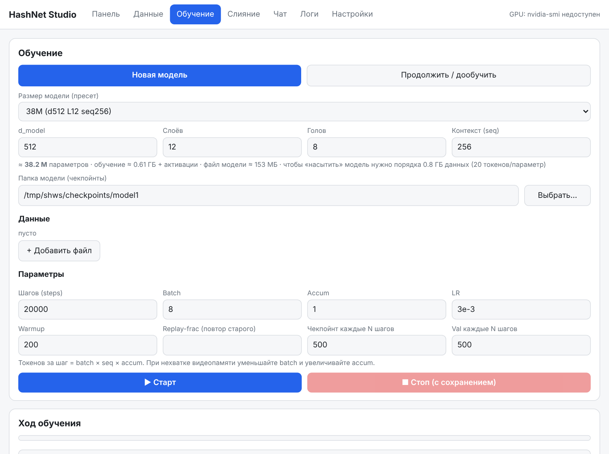
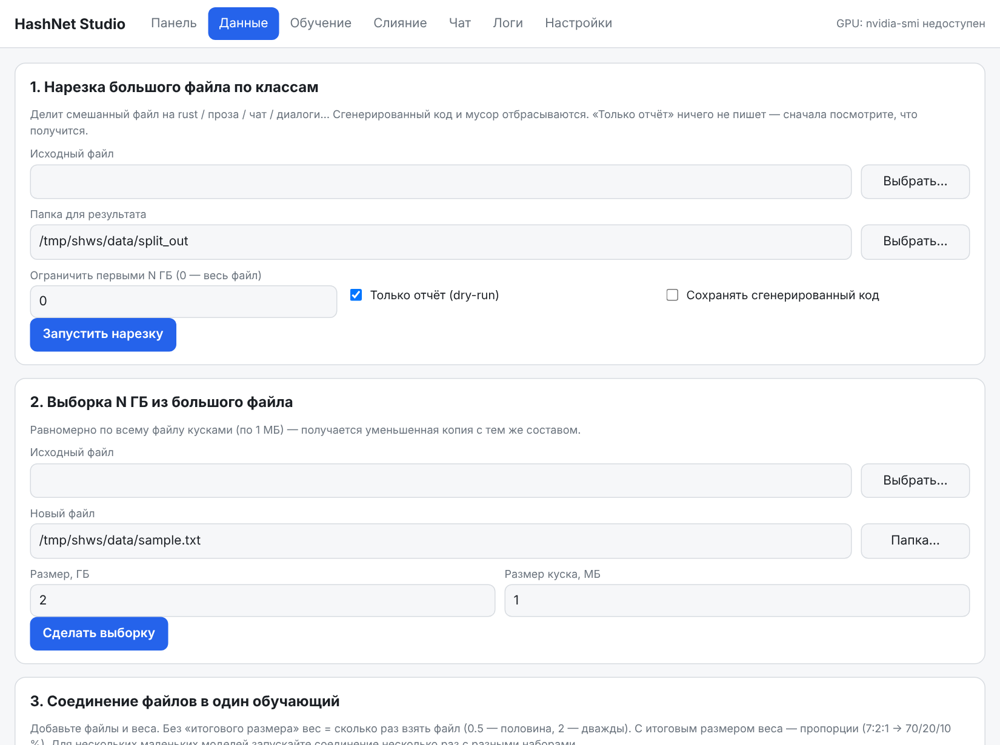
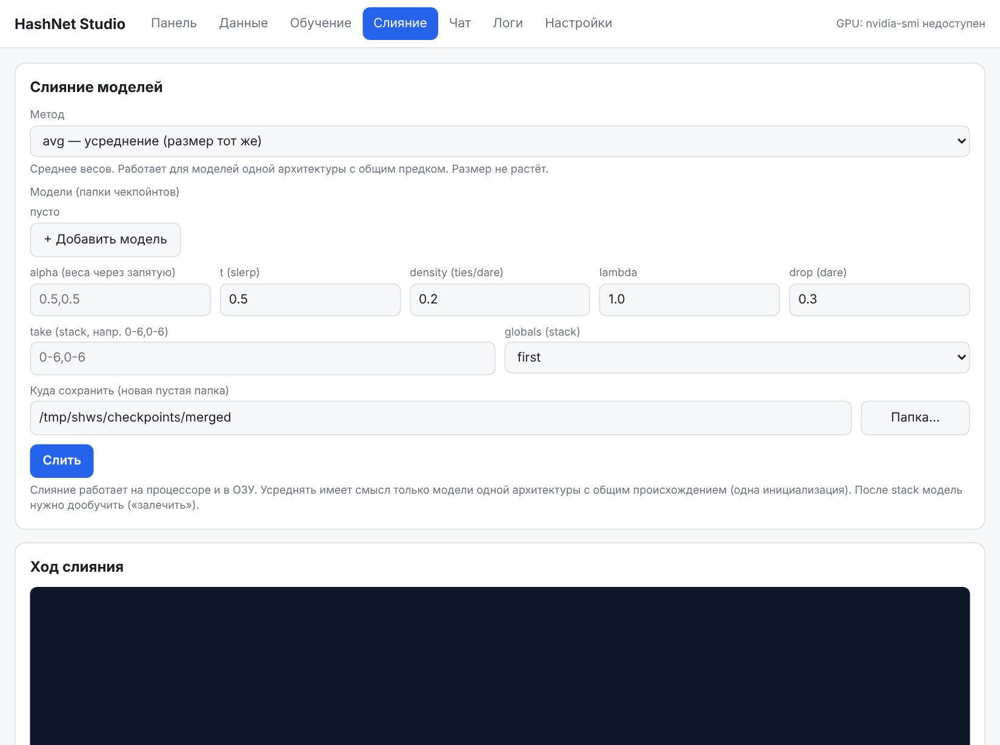

<div align="center">

# HashNet Studio

**Байтовый трансформер с тернарными весами (BitNet b1.58), который обучается на обычной домашней видеокарте — вместе с оболочкой для данных, обучения, слияния и чата.**


-lightgrey)


</div>

---

## Что это

* **`hashnet_proto`** — трансформер на Rust, который работает прямо с **байтами** (словарь 256, без токенизатора). Веса проекций — тернарные `{-1, 0, +1}` (≈1.58 бита), активации — 8 бит. Обучение с «латентными» f32-весами, которые квантуются на каждом шаге (QAT); CUDA-ядра компилируются на лету через NVRTC (`cudarc 0.19`).
* **Инференс** — на целочисленных тернарных ядрах с KV-кэшем: матрицы модели на 38M параметров занимают **≈7 МБ**.
* **HashNet Studio** — локальный веб-интерфейс (только стандартный Python, ничего ставить не нужно): нарезка и смешивание данных, обучение с остановкой и продолжением, слияние моделей, чат, живые логи и график.
* **Инструменты данных** — классификатор корпуса (отделяет живой Rust от сгенерированного кода, мусора, чатов и прозы), выборка N ГБ, смешивание файлов с весами, конвертер StarCoderData.

<p align="center">
  
  
</p>
<p align="center"></p>

## Результаты

Всё измерено на **RTX 4060 (8 ГБ), 32 ГБ ОЗУ**.

### Модели

| Конфигурация | Параметров | Из них тернарных матриц | Память обучения* | Скорость обучения |
|---|---:|---:|---:|---:|
| d256 · 4 слоя · 8 голов · seq 512 | 3.4 M | — | ≈ 0.05 ГБ | ≈ 33 400 ток/с (batch 8) |
| d512 · 12 слоёв · 8 голов · seq 256 | 38.17 M | 37.75 M | ≈ 0.6 ГБ | ≈ 10 500 ток/с (batch 16) |
| d768 · 12 слоёв · 12 голов · seq 1024 | 86.15 M | 84.93 M | ≈ 1.4 ГБ + активации | ≈ 3 650 ток/с, процесс ≈ 4.4 ГБ VRAM |

\* веса f32 + Adam (m, v) + градиенты ≈ 16 байт на параметр; активации сверху зависят от batch × seq.
Val считается на хвосте каждого файла, поэтому цифры разных запусков сравнимы только при одинаковых данных и контексте (seq).
Формула числа параметров: `12·L·d² + 256·d·2 + seq·d + 2·d + 4·d·L`.

### Качество

| Эксперимент | Данные | Результат |
|---|---|---|
| Модель 3.4M (d256·4·seq 512), 20 000 шагов, 41 мин | 2 ГБ чистого Rust (модель увидела ≈ 82 МБ) | **val 0.99 бит/байт**, генерация воспроизводит синтаксис Rust (отступы, скобки, вызовы), смысл имён пока выдуман |
| Модель 38M, seq 256, обучение с нуля | 2 ГБ чистого Rust | **val ≈ 1.05 бит/байт** (для сравнения: случайные байты = 8) |
| Усреднение двух независимо обученных моделей | то же | val **1.84** бит/байт — **хуже**, генерация превращается в мусор |

Второй результат — честный отрицательный: **усреднять веса моделей, обученных независимо с нуля, нельзя**. Слияние работает для веток от общей базы (дообучение на разных данных, короткая дистанция от базы) и для склейки слоёв (`stack`), после которой модель нужно дообучить. Подробности — в [руководстве](docs/GUIDE.md#5-слияние-вкладка-слияние).

### Данные, на которых это построено

| Этап | Что получилось |
|---|---|
| Исходный корпус | ≈ 10 ГБ кода StarCoderData (parquet → текст) |
| Очистка и нарезка `split_corpus.py` | **8.78 ГБ чистого Rust** (сгенерированный код — prost, bindgen, windows-rs, lalrpop, gir, svd2rust — и мусор отброшены) |
| Рабочая выборка `sample_corpus.py` | **≈ 2.0 ГБ** равномерно по всему файлу |
| Классы смешанного корпуса | rust · rust_generated · junk · chat_code · chat_ru · chat_en · dialog_ru · prose_ru · prose_en · code_other |

## Быстрый старт

Нужны: Linux, драйвер NVIDIA + CUDA toolkit (`nvcc`), [Rust](https://rustup.rs), Python 3.8+.

```bash
git clone https://github.com/Reppatola/hashnet-studio.git
cd hashnet-studio
./start.sh          # откроется http://127.0.0.1:8765/?t=КЛЮЧ
```

В интерфейсе: **Данные** → подготовьте файл → **Обучение** → «Новая модель» → **Старт** → **Чат**.
Первая задача сама соберёт программу (`cargo build --release`, 1–3 минуты).

То же без интерфейса:

```bash
cd rust && cargo build --release
./target/release/hashnet_proto train --ckpt-dir ../workspace/checkpoints/m38 \
    --d-model 512 --layers 12 --heads 8 --seq 256 \
    --data ../workspace/data/rust_2gb.txt --steps 20000 --batch 8
# Ctrl+C сохраняет чекпойнт; продолжить с того же места:
./target/release/hashnet_proto train --resume --ckpt-dir ../workspace/checkpoints/m38 --steps 20000
./target/release/hashnet_proto gen --ckpt ../workspace/checkpoints/m38 --prompt "fn main() {" --len 300 --no-repeat 4
```

Полный набор команд «с нуля до финала» — в **[docs/GUIDE.md](docs/GUIDE.md)**.

## Возможности

* **Остановка и продолжение без потерь** — Ctrl+C / «Стоп» сохраняет чекпойнт (веса, Adam, позиция в данных, ГСЧ); `--resume` продолжает с того же шага.
* **Фазы и повтор** — дообучение на новых данных (`--new-phase`) с долей старых (`--replay-frac`) и контролем забывания: val на старых данных до и после фазы.
* **Взвешенные данные** — `--data файл@вес`; окна выбираются случайно по всему файлу, валидация — хвост каждого сегмента.
* **Слияние** — `avg`, `slerp`, `task`, `ties`, `dare`, `stack`; работает на CPU/в ОЗУ.
* **Генерация** — температура, top-k, `--no-repeat N` против зацикливания.
* **Безопасная оболочка** — слушает только `127.0.0.1`, запросы только с одноразовым ключом, запускаются лишь заранее известные команды; под каждой кнопкой показан эквивалент для терминала.

## Структура

```
hashnet-studio/
├─ app.py, start.sh      оболочка (stdlib Python)
├─ ui/index.html         интерфейс
├─ rust/                 hashnet_proto: model.rs, gpu.rs, data.rs, ckpt.rs, infer.rs, merge.rs, *.cu
├─ tools/                split_corpus, sample_corpus, mix_files, starcoder_to_txt, fetch_repos
├─ docs/GUIDE.md         подробное руководство и решение проблем
└─ workspace/            data/, checkpoints/, logs/  (не попадают в git)
```

## Ограничения (честно)

* Модель — **байтовая**: 1 байт = 1 токен, поэтому контекст короткий (256–1024 байта), а обучение требует много шагов. Ёмкость ≈ 2 бита на параметр: десятки гигабайт кода в модель 38M не поместятся.
* Это не ассистент: модель **продолжает** текст/код, а не отвечает на вопросы.
* Проверялось на одной видеокарте (RTX 4060) под Linux (Pop!_OS). Другие GPU и ОС не тестировались.
* Идея «обучить 10 моделей на кусках и усреднить» от общего старта с нуля не даёт выигрыша — см. результаты выше.

## Лицензия

[MIT](LICENSE)
